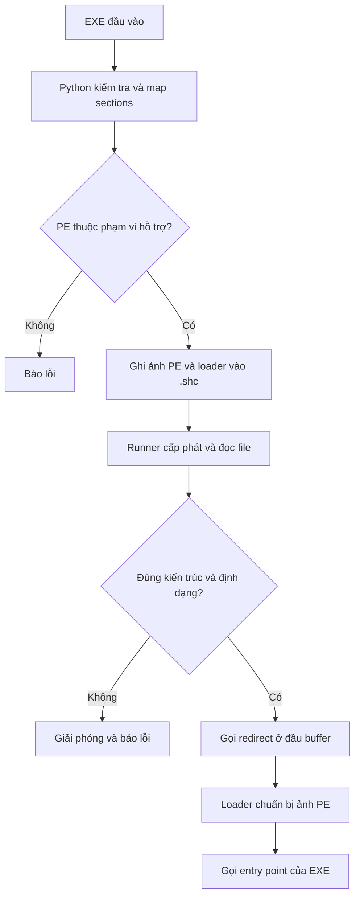

# pe2shc lite

**Ý tưởng chính:** converter dựng trước layout bộ nhớ của EXE, đặt một đoạn chuyển hướng ở đầu buffer và nối một loader vào cuối. Khi runner gọi đầu buffer, loader sửa những thành phần phụ thuộc môi trường chạy rồi gọi entry point của EXE.

Loader runtime x86/x64 là **mã máy `loader_v2` được giữ nguyên từ `hasherezade/pe_to_shellcode`**, commit `49ba145dac7761c63563617db8d54cde39e4149d`. Python và runner C là phần triển khai của bản Simple; không phải toàn bộ loader đã được viết lại bằng Python.

## Mục lục

- [1. Ba thành phần và hai giai đoạn](#1-ba-thành-phần-và-hai-giai-đoạn)
- [2. File offset, RVA và VA trong bài toán này](#2-file-offset-rva-và-va-trong-bài-toán-này)
- [3. Python đọc và kiểm tra EXE](#3-python-đọc-và-kiểm-tra-exe)
- [4. Dựng ảnh PE theo layout bộ nhớ](#4-dựng-ảnh-pe-theo-layout-bộ-nhớ)
- [5. Kiểm tra khả năng dùng loader v2](#5-kiểm-tra-khả-năng-dùng-loader-v2)
- [6. Các byte và headers được sửa trong đầu ra](#6-các-byte-và-headers-được-sửa-trong-đầu-ra)
- [7. Redirect: CPU đi từ byte đầu tới loader như thế nào?](#7-redirect-cpu-đi-từ-byte-đầu-tới-loader-như-thế-nào)
- [8. Runner C thực hiện những gì?](#8-runner-c-thực-hiện-những-gì)
- [9. Loader tự tìm API ban đầu](#9-loader-tự-tìm-api-ban-đầu)
- [10. Relocations: sửa những địa chỉ phụ thuộc ImageBase](#10-relocations-sửa-những-địa-chỉ-phụ-thuộc-imagebase)
- [11. Imports: từ thông tin tên hàm tới IAT có địa chỉ thật](#11-imports-từ-thông-tin-tên-hàm-tới-iat-có-địa-chỉ-thật)
- [12. TLS callbacks và lý do không hỗ trợ static TLS đầy đủ](#12-tls-callbacks-và-lý-do-không-hỗ-trợ-static-tls-đầy-đủ)
- [13. Gọi entry point, status và các mã trả về](#13-gọi-entry-point-status-và-các-mã-trả-về)
- [14. Một ví dụ xuyên suốt từ EXE tới địa chỉ chạy](#14-một-ví-dụ-xuyên-suốt-từ-exe-tới-địa-chỉ-chạy)
- [15. Phạm vi hỗ trợ và những gì Windows loader còn làm thêm](#15-phạm-vi-hỗ-trợ-và-những-gì-windows-loader-còn-làm-thêm)


## 1. Ba thành phần và hai giai đoạn

| Thành phần | Chạy lúc nào? | Trách nhiệm |
|---|---|---|
| `pe2shc.py` | Khi chuyển đổi | Đọc và kiểm tra PE, map sections, sửa headers, nối loader, ghi `.shc` |
| Loader nhúng trong `.shc` | Khi thực thi | Tìm API, áp dụng relocations, giải quyết imports, chạy TLS callbacks và entry point |
| `runshc.c` / runner `.exe` | Khi thực thi | Đọc `.shc` vào bộ nhớ có quyền thực thi và gọi địa chỉ đầu buffer |

Có hai giai đoạn độc lập:

- **Chuyển đổi:** Python xử lý byte. EXE đầu vào chưa được thực thi. Giai đoạn này làm được trên Windows hoặc Linux/WSL.
- **Thực thi:** runner Windows gọi mã máy đã tạo. Runner, loader và EXE phải cùng kiến trúc.



Đuôi `.shc` chỉ là tên file. Phần làm nó chạy được là **cấu trúc byte và loader bên trong**, cùng runner cấp phát vùng nhớ phù hợp. Python không dịch lại mã C/C++, không lấy riêng `.text`, và không cần có source của EXE.

## 2. File offset, RVA và VA trong bài toán này

Ba loại địa chỉ phải được phân biệt:

| Khái niệm | Ý nghĩa | Ví dụ |
|---|---|---|
| File offset | Vị trí byte tính từ đầu file trên đĩa | `.text` bắt đầu tại `0x400` |
| RVA | Độ lệch tính từ base của ảnh PE | `.text` có RVA `0x1000` |
| VA | Địa chỉ thực trong không gian địa chỉ tiến trình | `BaseAddress + RVA` |

Với một RVA nằm trong **phần có dữ liệu trên đĩa** của section:

```text
file_offset = section.PointerToRawData
            + (RVA - section.VirtualAddress)

VA = BaseAddress + RVA
```

Phần zero-fill của section có thể có RVA nhưng không có byte tương ứng trong file gốc. `ImageBase` trong Optional Header là base ưu tiên; `BaseAddress` là địa chỉ runner thực sự nhận được khi cấp phát.

Giả sử `.text` có `PointerToRawData = 0x400`, `VirtualAddress = 0x1000`. Byte ở RVA `0x1050` nằm tại offset `0x450` trong EXE gốc. Nếu chỉ đọc nguyên file vào buffer rồi dùng `base + 0x1050`, CPU sẽ không đọc đúng byte mong muốn.

Do đó, bước map phải đưa byte đó từ offset `0x450` sang offset `0x1050` trong buffer đầu ra. Sau bước này, **offset trong ảnh đã map bằng RVA** đối với nội dung ảnh PE. Các định nghĩa PE nền tảng được đối chiếu với [đặc tả PE/COFF của Microsoft](https://learn.microsoft.com/en-us/windows/win32/debug/pe-format).

## 3. Python đọc và kiểm tra EXE

Điểm bắt đầu của converter là `main()`. Hàm này nhận đường dẫn đầu vào và tùy chọn `-o`, kiểm tra kích thước file, đọc bytes rồi gọi:

```python
blob, bits = convert(data)
```

`blob` là nội dung `.shc`; `bits` bằng `32` hoặc `64`. Việc mở file đầu ra chỉ diễn ra sau khi chuyển đổi thành công.

### 3.1. Các hàm đọc cơ bản

- `require(condition, message)`: ném `ValueError` nếu điều kiện không thỏa.
- `number(data, offset, fmt)`: kiểm tra biên rồi đọc một số little-endian. `H`, `I`, `Q` lần lượt là 2, 4, 8 byte.
- `cstring(image, rva)`: kiểm tra một tên import không rỗng và có byte NUL kết thúc trong tối đa 4.096 byte được xét.

Ví dụ `number(data, 0x3C)` lấy DWORD `e_lfanew`, tức file offset của NT headers. Tên `cstring()` ở đây không có nghĩa Python đang gọi API C; nó chỉ kiểm tra chuỗi byte trong PE.

### 3.2. DOS, NT và Optional Header

`convert()` kiểm tra lần lượt:

1. File dài từ 64 byte đến 256 MiB và bắt đầu bằng `MZ`.
2. Không bắt đầu bằng dấu hiệu `MZER\xE8` của output đã chuyển đổi.
3. `e_lfanew` trỏ tới vùng hợp lệ có signature `PE\0\0`.
4. Cặp `Machine` / `OptionalHeader.Magic` thuộc một trong hai trường hợp sau.

| Kiến trúc | `Machine` | `Magic` | Kích thước con trỏ | Offset DataDirectory từ đầu Optional Header |
|---|---|---|---|---|
| x86 | `0x014C` | `0x010B` - PE32 | 4 byte | 96 byte |
| x64 | `0x8664` | `0x020B` - PE32+ | 8 byte | 112 byte |

Đây là nhận diện bằng header, không dựa vào tên file hoặc kiến trúc của Python đang chạy.

Bản Simple yêu cầu Optional Header đủ chứa **16 data directories**, và `NumberOfRvaAndSizes` đúng bằng 16. Đây là giới hạn của implementation hiện tại, không phải khẳng định rằng mọi PE khác đều sai định dạng.

Trong COFF Characteristics, cờ executable image phải có, cờ DLL và relocations stripped phải không có. Subsystem chỉ nhận GUI (`2`) hoặc console (`3`). Vì vậy một DLL đổi tên thành `.exe` vẫn bị từ chối.

### 3.3. Những giới hạn layout được kiểm tra

| Thành phần | Điều kiện trong converter |
|---|---|
| `SectionAlignment` | Lũy thừa của 2, từ `0x1000` đến `0x10000` |
| `FileAlignment` | Lũy thừa của 2, từ `0x200` đến `SectionAlignment` |
| `SizeOfImage` | Khác zero, không quá 256 MiB, chia hết cho `SectionAlignment` |
| Số section | Từ 1 đến 96 |
| `SizeOfHeaders` | Bao phủ section table, không vượt file/ảnh, căn theo `FileAlignment` gốc |
| Vùng ảo của section | `VirtualSize > 0`; RVA căn đúng; các section theo thứ tự, không chồng nhau |
| Dữ liệu raw | Trong file, căn đúng, không chồng raw của section khác |
| Entry point | Nằm trong `VirtualSize` của một section có cờ executable |

Các điều kiện này thu hẹp đầu vào về layout thông thường để phù hợp loader nhỏ được nhúng. Converter có thể từ chối một PE mà Windows loader đầy đủ vẫn xử lý được.

## 4. Dựng ảnh PE theo layout bộ nhớ

Converter tạo một buffer có đúng kích thước `SizeOfImage`:

```python
image = bytearray(size)
image[:headers] = data[:headers]
```

`bytearray(size)` khởi tạo toàn bộ bằng zero. Headers được giữ ở đầu ảnh; các section được đặt lại theo RVA:

```python
image[va:va + raw_size] = data[raw:raw + raw_size]
```

Ở đây:

- `va` là `section.VirtualAddress`, tức **RVA** dù tên trường có chữ “Address”.
- `raw` là `PointerToRawData`.
- `raw_size` là `SizeOfRawData`.

Vùng dùng để kiểm tra section và realign được tính bằng:

```text
span = align_up(VirtualSize, SectionAlignment)
     = ((VirtualSize + SectionAlignment - 1) // SectionAlignment)
       * SectionAlignment
```

Converter cho phép raw data lớn hơn `VirtualSize` do padding của file, nhưng phải không vượt `span`. Phần ảnh không được copy dữ liệu sẽ giữ giá trị zero; điều này bao gồm phần dữ liệu chưa khởi tạo trong trường hợp section có raw size nhỏ hơn vùng ảo.

Sau bước này, các thư mục import, relocation, TLS vẫn chứa RVA/VA theo PE gốc. **Chúng chưa được sửa theo địa chỉ chạy thực tế**: Python chưa biết `VirtualAlloc` sẽ chọn địa chỉ nào.

## 5. Kiểm tra khả năng dùng loader v2

`check_loader()` nhận ảnh đã map và thực hiện kiểm tra bổ sung trước khi đóng gói. Nó **kiểm tra** dữ liệu relocation/import/TLS; việc **áp dụng** chúng xảy ra sau này trong loader khi thực thi.

### 5.1. Data directories

Các directory có RVA khác zero, trừ Security Directory dùng file offset, phải nằm trong `SizeOfImage`. Bản Simple từ chối ngay khi thấy:

| Index | Directory | Lý do |
|---|---|---|
| 11 | Bound Import | Loader đọc FirstThunk như bảng lookup ban đầu |
| 13 | Delay Import | Loader không có bước giải quyết delay imports |
| 14 | CLR / COM Descriptor | Loader không khởi tạo môi trường .NET |

### 5.2. Relocations và các đặc điểm riêng của upstream

Directory số 5 phải có RVA và size khác zero. Với mỗi block, converter kiểm tra kích thước tối thiểu 8 byte, bội số của 4 và không vượt vùng directory đã khai báo.

Các entry 16-bit chỉ được dùng loại:

- `IMAGE_REL_BASED_HIGHLOW = 3` với x86.
- `IMAGE_REL_BASED_DIR64 = 10` với x64.
- `IMAGE_REL_BASED_ABSOLUTE = 0` cho padding cuối block.

Có hai kiểm tra xuất phát trực tiếp từ code loader gốc:

1. Loader **dừng block ở entry loại 0 đầu tiên**. Vì vậy converter không cho phép một relocation có ý nghĩa xuất hiện sau padding loại 0 trong cùng block.
2. Loader **không dùng `directory.Size` làm điều kiện kết thúc vòng lặp**; nó đọc cho đến một block có `PageRVA = 0`. Vì vậy ảnh phải có DWORD zero ở vị trí kết thúc mà loader sẽ đọc tiếp.

Converter còn loại relocation trỏ vào headers, trỏ vượt ảnh hoặc trùng chính xác địa chỉ đích đã gặp. Block có `SizeOfBlock < 8` bị từ chối, tránh nhánh `continue` không tăng con trỏ trong loader gốc.

Những điều kiện này là kiểm tra tương thích cho stub hiện tại, không phải quy tắc tổng quát áp dụng cho mọi PE loader.

### 5.3. Imports

Converter duyệt các descriptor trong phạm vi Import Directory, yêu cầu có descriptor kết thúc và kiểm tra tên DLL, FirstThunk, các entry import theo tên/ordinal. Timestamp của descriptor phải bằng zero trong phạm vi được nhận.

Một import theo tên trỏ đến `IMAGE_IMPORT_BY_NAME`: hai byte đầu là hint, tên hàm bắt đầu sau đó. Import theo ordinal dùng bit cao nhất để đánh dấu, phần ordinal nằm ở 16 bit thấp.

Kiểm tra này không tải DLL, không biết DLL đó có thực sự tồn tại trên máy Windows hay không và không gọi `GetProcAddress`.

### 5.4. TLS

Nếu có TLS Directory, kích thước tối thiểu phải là 24 byte với x86 hoặc 40 byte với x64. Converter yêu cầu `StartAddressOfRawData == EndAddressOfRawData` và `SizeOfZeroFill == 0`, tức không có phần static TLS data cần thiết lập.

Nếu có mảng callbacks, địa chỉ của mảng và các con trỏ callback phải có relocation tương ứng. Các callback phải trỏ vào phạm vi ảnh được chấp nhận. Tuy nhiên, kiểm tra này không xác minh mọi lệnh bên trong callback hoặc toàn bộ ngữ nghĩa của TLS.

## 6. Các byte và headers được sửa trong đầu ra

Sau khi kiểm tra xong, Python mới sửa ảnh để đóng gói:

| Vị trí / trường | Thao tác |
|---|---|
| Đầu DOS header | Ghi đoạn redirect x86 hoặc x64 |
| Offset `0x20` | Ghi `0`, tương ứng `LDS_CLEAN` |
| `e_lfanew` tại `0x3C` | Giữ nguyên để loader tìm NT headers |
| `FileAlignment` | Đổi thành `SectionAlignment` |
| Section `VirtualSize`, `SizeOfRawData` | Đặt bằng `span` đã căn chỉnh |
| Section `PointerToRawData` | Đặt bằng `VirtualAddress` |
| `CheckSum` | Đặt bằng zero |
| COFF symbol table pointer/count | Đặt bằng zero |
| Security / Debug directories | Xóa hai cặp giá trị directory |
| `ImageBase`, entry RVA, `SizeOfImage`, số section | Giữ nguyên |

Security Directory và Debug Directory chứa/liên quan đến file offsets cũ; việc xóa directory không có nghĩa mọi byte từng thuộc debug data đã bị xóa khỏi section. Overlay và certificate nằm ngoài các vùng được map không được copy sang ảnh.

`SizeOfHeaders` không được tăng cho khớp `FileAlignment` mới. Stub cũng không được khai báo thành section mới. Vì vậy tài liệu này mô tả **đường chạy qua runner**; không cam kết đổi đuôi output thành `.exe` sẽ tạo một EXE được Windows loader chấp nhận như bình thường.

### 6.1. Nối loader

Trong `pe2shc.py`, `STUB_BASE64[32]` và `STUB_BASE64[64]` chứa dữ liệu nhị phân upstream dưới dạng chuỗi Base64. Converter giải mã, kiểm tra SHA-256 rồi nối vào cuối ảnh:

```python
stub = base64.b64decode(STUB_BASE64[bits])
return bytes(image) + stub, bits
```

| Kiến trúc | Kích thước stub | SHA-256 |
|---|---|---|
| x86 | 1.024 byte, `0x400` | `9c703588c7d8e1e4f0e949da269eee353bba661eadcd3011c829dde778526acf` |
| x64 | 1.536 byte, `0x600` | `e79c91e8157fef862be8cbe80bdf57b87a541416717265f81f669d751fca4a3d` |

Base64 là cách lưu bytes trong source; output chứa mã máy đã giải mã. SHA-256 ở đây phát hiện stub bị thay đổi so với hằng số đi kèm, không phải chữ ký số cho toàn bộ `.shc`.

### 6.2. Layout cuối cùng

| Khoảng offset | Nội dung |
|---|---|
| Từ `0` đến trước `SizeOfHeaders` | Headers, có redirect và status được vá |
| Các RVA của section | Code/data của EXE đã map, cùng padding |
| `SizeOfImage` | Byte đầu loader được nối thêm |
| `SizeOfImage + stub_size` | Kết thúc file |

Do đó:

```text
loader_offset = SizeOfImage
output_size   = SizeOfImage + stub_size
```

Đầu ra thường lớn hơn file gốc vì các khoảng trống theo layout ảo được hiện thực thành byte zero. Đây không phải một cơ chế nén PE.

## 7. Redirect: CPU đi từ byte đầu tới loader như thế nào?

Runner gọi địa chỉ **đầu buffer**, trong khi entry point thực của EXE có thể ở RVA `0x1000` hoặc nơi khác. Redirect là đoạn mã ngắn nối hai vị trí này: xác định base của chính nó, tính địa chỉ loader, gọi loader và trả về runner.

### 7.1. Bốn byte `MZER`

Bốn byte đầu là `4D 5A 45 52`. Hai byte đầu vẫn tạo signature `MZ`, đồng thời toàn bộ bốn byte có thể được CPU diễn giải thành lệnh:

| Kiến trúc | Cách giải mã |
|---|---|
| x86 | `dec ebp; pop edx; inc ebp; push edx` |
| x64 | `pop r10; push r10` - các byte `4D`, `45` tham gia prefix REX |

Trên x86, `dec/inc` khôi phục giá trị EBP; `pop/push` lấy rồi đặt lại giá trị ở đỉnh stack. Trên x64, cặp `pop/push` cũng khôi phục stack. Không nên gọi cả đoạn là NOP tuyệt đối: thanh ghi tạm và, ở x86, flags có thể thay đổi.

### 7.2. Tìm base bằng `call` và `pop`

Ở cả hai kiến trúc, lệnh `call` nằm tại offset `0x04`, dài 5 byte và có displacement bằng zero. Nó đẩy địa chỉ lệnh kế tiếp, tức `base + 9`, lên stack. `pop` lấy địa chỉ đó vào thanh ghi; trừ `9` cho ra base thực.

```text
return_address_from_call = base + 9
base = return_address_from_call - 9
```

Vì phép tính dùng địa chỉ đang thực thi, nó vẫn đúng khi `VirtualAlloc` cấp một base khác `ImageBase` ưu tiên.

### 7.3. Nhánh x86

Phần sau bốn byte mở đầu tương đương:

```asm
call next
next:
pop eax                  ; EAX = base + 9
sub eax, 9               ; EAX = base
push eax                 ; đối số module_base trên stack
add eax, SIZE_OF_IMAGE    ; EAX = địa chỉ loader
call eax
ret
```

Loader x86 nhận `module_base` theo `__stdcall`; phần trả về của loader dọn đối số trên stack. `ret` cuối redirect trả về địa chỉ mà lời gọi từ runner đã đặt lên stack.

### 7.4. Nhánh x64

```asm
call next
next:
pop rcx                  ; RCX = base + 9
sub rcx, 9               ; RCX = base, đối số thứ nhất
mov rax, rcx
add rax, SIZE_OF_IMAGE    ; RAX = địa chỉ wrapper của loader
call rax
ret
```

Trong ABI Windows x64, đối số nguyên/con trỏ thứ nhất đi qua RCX. Stub x64 bắt đầu bằng wrapper lưu RSI/RSP, căn stack theo 16 byte, dành `0x20` byte shadow space, gọi phần thân loader rồi khôi phục stack. Chính wrapper này xử lý yêu cầu ABI trước khi vào phần C/C++ đã biên dịch. Xem [Microsoft: x64 calling convention](https://learn.microsoft.com/en-us/cpp/build/x64-calling-convention?view=msvc-170).

### 7.5. Các vị trí vá

| Thuộc tính | x86 | x64 |
|---|---|---|
| Kích thước redirect được copy, kể cả byte NUL cuối | 23 byte | 27 byte |
| Offset immediate 32-bit chứa `SizeOfImage` | `15` / `0x0F` | `19` / `0x13` |
| Offset lệnh gọi loader | `0x13` | `0x17` |
| Offset `ret` | `0x15` | `0x19` |

Python dùng `len(redirect) - 8` để tìm vị trí immediate. Giá trị được ghi little-endian. Byte NUL cuối nằm sau `ret`; luồng thông thường không thực thi byte đó. Giới hạn ảnh 256 MiB cũng giữ offset loader trong miền dương của immediate 32-bit ở nhánh x64.

## 8. Runner C thực hiện những gì?

Windows loader nạp runner và khởi tạo CRT/TLS của runner theo cơ chế thông thường. Sau đó, loader nhúng xử lý EXE trong buffer `.shc`. Hỗ trợ TLS của hai bước này khác nhau. Lệnh build runner có thể dùng CRT, còn các EXE mẫu dùng `-nostdlib` để phù hợp giới hạn của loader nhúng.

`runshc.c` có một hàm chính `wmain()`. Nó được biên dịch hai lần: bản `_WIN64` thành `runshc.exe`, bản x86 thành `runshc32.exe`. `wmain` nhận đối số Unicode và `_wfopen` mở đường dẫn Unicode; `-municode` trong lệnh MinGW chọn startup phù hợp.

### 8.1. Đọc file vào vùng nhớ thực thi

Runner yêu cầu đúng một đối số là đường dẫn `.shc`, mở file, lấy kích thước và loại file nhỏ hơn 64 byte hoặc lớn hơn `268437504` byte, tức 256 MiB + 2 KiB.

Nó cấp phát bằng lời gọi sau rồi `fread` trực tiếp vào vùng nhớ đó:

```c
VirtualAlloc(NULL, size,
             MEM_COMMIT | MEM_RESERVE,
             PAGE_EXECUTE_READWRITE);
```

`NULL` cho phép Windows chọn địa chỉ. Reserve/commit chuẩn bị vùng địa chỉ cho dữ liệu; quyền đọc/ghi/thực thi cho phép loader sửa con trỏ và CPU chạy code trong cùng buffer. Runner cấp phát theo **toàn bộ kích thước file**, nên vùng loader nằm sau `SizeOfImage` cũng được chứa trong vùng nhớ hợp lệ. Xem [VirtualAlloc](https://learn.microsoft.com/en-us/windows/win32/api/memoryapi/nf-memoryapi-virtualalloc).

Các section đã được Python đặt đúng vị trí. Runner không cần map lại chúng lần nữa.

### 8.2. Kiểm tra trước khi gọi mã

Runner đọc `e_lfanew` bằng `memcpy`, kiểm tra NT signature và `Machine`. Sau đó nó kiểm tra:

- Input không mang cờ DLL.
- Prefix redirect đúng với bản x86/x64 đang chạy.
- Bốn byte sau immediate khớp `FF D0 C3 00`.
- Status tại `0x20` bằng zero.
- Offset loader tối thiểu 4 KiB, chia hết cho 4 KiB và không vượt file.
- Phần file còn lại sau offset loader dài đúng 1.024 hoặc 1.536 byte.

Đây là kiểm tra định dạng cơ bản của đầu ra Simple. Runner **không chạy lại toàn bộ validator Python và không kiểm tra SHA-256 của toàn file hoặc stub**. Các kiểm tra đó không chứng minh nội dung file sau khi bị chỉnh sửa vẫn hợp lệ để thực thi.

### 8.3. Gọi byte đầu tiên

Sau `FlushInstructionCache(GetCurrentProcess(), image, size)`, dòng quyết định là:

```c
result = ((int (__cdecl *)(void))(void *)image)();
```

Địa chỉ `image` được xem như địa chỉ một hàm không đối số, trả về `int`. CPU bắt đầu đọc lệnh ở offset zero, chạy redirect, rồi tới loader. `FlushInstructionCache` được dùng khi ứng dụng tạo hoặc sửa code trong bộ nhớ; API này không thay thế việc cấp quyền thực thi. Xem [tài liệu Microsoft](https://learn.microsoft.com/en-us/windows/win32/api/processthreadsapi/nf-processthreadsapi-flushinstructioncache).

Bản Simple gọi trực tiếp trên luồng đang chạy `wmain`; không có worker thread riêng. EXE dùng không gian địa chỉ, môi trường tiến trình và các tài nguyên của runner.

Nếu lời gọi trở về, runner in `result` và status rồi giải phóng buffer bằng:

```c
VirtualFree(image, 0, MEM_RELEASE);
```

Size bằng zero với `MEM_RELEASE` yêu cầu trả lại toàn bộ vùng đã reserve. Xem [VirtualFree](https://learn.microsoft.com/en-us/windows/win32/api/memoryapi/nf-memoryapi-virtualfree). Nếu EXE gọi `ExitProcess`, việc điều khiển không trở về các dòng in/giải phóng này; tiến trình kết thúc theo hành vi của EXE.

## 9. Loader tự tìm API ban đầu

Loader cần `LoadLibraryA` và `GetProcAddress` để xử lý imports của EXE. Nhưng chính nó là một đoạn mã máy nhúng, nên phải tìm được hai API trước khi dựa vào IAT của chương trình.

Trong source upstream, trách nhiệm này thuộc `init_iat()`, `get_module_by_checksum()` và `get_func_by_checksum()`.

### 9.1. Tìm module qua PEB

Helper lấy con trỏ PEB qua `FS:[0x30]` trên x86 hoặc `GS:[0x60]` trên x64, rồi duyệt `PEB->Ldr->InMemoryOrderModuleList` để xét các module đã nạp.

Nó tính checksum tên module, so với hằng số cho `kernel32.dll`, và lấy `DllBase` của module phù hợp. Việc tìm theo tên tránh phụ thuộc vào giả định một DLL luôn nằm ở một vị trí cố định trong danh sách.

### 9.2. Tìm export và dựng bảng API nhỏ

Từ base của module, helper đọc Export Directory và ba bảng `AddressOfNames`, `AddressOfNameOrdinals`, `AddressOfFunctions`. Với một tên khớp checksum, ordinal-table entry chọn chỉ số trong bảng hàm; địa chỉ được tính bằng `module_base + function_RVA`.

| Đối tượng | Hằng số trong upstream |
|---|---|
| `kernel32.dll` | `0x6AE69F02` |
| `GetProcAddress` | `0xC97C1FFF` |
| `LoadLibraryA` | `0x3FC1BD8D` |

Hàm checksum dùng phép cập nhật kiểu CRC với polynomial `0xEDB88320`, giá trị đầu `0xFFFFFFFF`, lấy bù bit ở cuối. Tên module được chuyển ASCII hoa thành thường trước khi tính; tên export phân biệt hoa/thường. Với tên module kiểu WCHAR, code xử lý 8 bit cho mỗi ký tự; không nên mô tả nó là CRC trực tiếp trên toàn bộ bytes UTF-16 của tên.

Kết quả được giữ trong `t_mini_iat`, một struct có hai con trỏ hàm. Bảng này phục vụ loader; nó khác với IAT của EXE cần được điền sau đó.

**Giới hạn cần phân biệt:** helper bootstrap của upstream không có bước phát hiện/resolve forwarded export. Nếu một export bootstrap trả về RVA của chuỗi forwarder, việc chỉ cộng module base không tạo ra địa chỉ hàm đúng. Trong khi đó, các imports của EXE được giải quyết bằng API Windows `GetProcAddress` đã tìm được. Đây là hai đường xử lý khác nhau.

Các hành vi ở phần này được đọc trực tiếp từ [peb_lookup.h của commit đã ghim](https://github.com/hasherezade/pe_to_shellcode/blob/49ba145dac7761c63563617db8d54cde39e4149d/loader_v2/peb_lookup.h).

## 10. Relocations: sửa những địa chỉ phụ thuộc ImageBase

Giả sử linker tạo một con trỏ tuyệt đối trong EXE dựa trên `ImageBase` ưu tiên, nhưng runner cấp phát ở địa chỉ khác. Giá trị con trỏ cần dịch cùng độ lệch:

```text
delta     = actual_base - preferred_ImageBase
new_value = old_value + delta
          = old_value - preferred_ImageBase + actual_base
```

Loader upstream đọc mỗi relocation block có `PageRVA`, `SizeOfBlock` và danh sách entry 16-bit. Bốn bit cao của entry là type; 12 bit thấp là offset trong page. Vị trí cần sửa là:

```text
target_RVA     = PageRVA + entry_offset
target_address = actual_base + target_RVA
```

Tại vị trí đó, loader đọc/sửa DWORD cho x86 hoặc QWORD cho x64. Nó không quét và cộng delta vào mọi byte trông giống con trỏ: danh sách relocation do PE cung cấp quyết định chỗ nào được sửa.

Ví dụ x64:

| Đại lượng | Giá trị minh họa |
|---|---|
| Preferred ImageBase | `0x140000000` |
| Base thực tế | `0x180000000` |
| Pointer cũ trong ảnh | `0x140001050` |
| Delta | `0x40000000` |
| Pointer sau relocation | `0x180001050` |

Một RVA như `AddressOfEntryPoint = 0x1050` không cần cộng delta trực tiếp vào trường header: nó vẫn là RVA. Khi dùng nó, loader cộng **base thực tế**.

Loader không đổi trường `OptionalHeader.ImageBase` thành base mới. Trường đó vẫn cung cấp base ưu tiên để tính delta. Relocations sửa các vị trí được chỉ ra trong ảnh chạy.

## 11. Imports: từ thông tin tên hàm tới IAT có địa chỉ thật

Sau relocations, loader xử lý Import Directory. Với mỗi `IMAGE_IMPORT_DESCRIPTOR`, nó:

1. Lấy tên DLL bằng `base + descriptor.Name`.
2. Gọi `LoadLibraryA` để lấy module handle.
3. Đọc các entry tại `base + descriptor.FirstThunk`.
4. Với import theo tên, bỏ qua hint 2 byte để lấy tên; với import theo ordinal, lấy 16 bit thấp.
5. Gọi `GetProcAddress` và ghi địa chỉ trả về vào chính entry FirstThunk đang xét.

Vì vậy bảng FirstThunk thay đổi vai trò trong lúc nạp:

| Thời điểm | Nội dung một entry |
|---|---|
| Trước resolve | RVA của `IMAGE_IMPORT_BY_NAME` hoặc giá trị đánh dấu ordinal |
| Sau resolve | Địa chỉ thực của hàm trong DLL đã được nạp |

Khi EXE gọi một hàm qua IAT, CPU lúc này lấy được địa chỉ thật thay vì một RVA/tên import chưa được resolve.

Một điểm đặc trưng của loader v2 là nó đọc và ghi **FirstThunk**, không lấy bảng lookup từ `OriginalFirstThunk`. Vì vậy FirstThunk đầu vào phải còn chứa dữ liệu lookup phù hợp. Bản Simple từ chối Bound Import Directory và descriptor có timestamp khác zero; validator cũng kiểm tra các thunk thực tế trước khi tạo output.

Việc converter chạy thành công trên Linux không bảo đảm `LoadLibraryA` thành công trên Windows: DLL phụ thuộc còn phải tồn tại và phù hợp kiến trúc trên máy chạy. Python không đóng gói thêm những DLL đó vào `.shc`.

## 12. TLS callbacks và lý do không hỗ trợ static TLS đầy đủ

TLS Directory có các trường địa chỉ dạng **VA**, gồm cả `AddressOfCallBacks`. Mảng callback cũng chứa con trỏ VA. Đây là lý do relocation phải chạy trước khi loader sử dụng chúng.

Loader lấy mảng callbacks đã được sửa địa chỉ, duyệt đến con trỏ zero rồi gọi từng callback với ba đối số:

```text
callback(image_base, DLL_PROCESS_ATTACH, NULL)
```

Các callbacks chạy trước entry point. Tên hằng `DLL_PROCESS_ATTACH` là reason code được dùng trong giao diện TLS callback, kể cả khi ảnh đang xét là EXE.

Tuy nhiên, loader v2 không tạo TLS slot/index, không cấp phát và copy static TLS template đầy đủ cho từng thread, cũng không tái hiện toàn bộ các thông báo vòng đời thread/process. Nó chỉ có bước gọi callback khi nạp.

Do đó, `check_loader()` chỉ nhận loại TLS không có template dữ liệu/zero-fill cần khởi tạo. Một callback vẫn có thể phụ thuộc vào trạng thái khác mà loader không cung cấp, nên “có callback và được converter nhận” không tự chứng minh toàn bộ EXE tương thích.

## 13. Gọi entry point, status và các mã trả về

Sau imports và TLS, loader tính:

```text
entry_address = actual_base + OptionalHeader.AddressOfEntryPoint
```

Với EXE, nó gọi địa chỉ đó như một hàm `int(void)`. `AddressOfEntryPoint` không đồng nghĩa với hàm C `main()`; với chương trình dùng CRT, đây thường là startup code của runtime. Bản Simple không tự gọi `main(argc, argv)` hay chuẩn bị một bộ tham số riêng cho EXE.

### 13.1. Status tại offset 0x20

`peloader.h` định nghĩa các trạng thái:

| Giá trị | Tên | Vai trò |
|---|---|---|
| 0 | `LDS_CLEAN` | Buffer mới, chưa qua quá trình nạp |
| 1 | `LDS_LOADED` | Trạng thái trung gian sau giai đoạn chuẩn bị |
| 2 | `LDS_RUN` | Được đặt trước lời gọi entry; cũng chặn chạy lại cùng buffer |
| 3 | `LDS_ATTACHED` | Trạng thái nhánh DLL trong upstream; đầu vào DLL bị bản Simple từ chối |

Trong đường EXE thông thường, status chuyển `0 → 1 → 2`. Sau khi entry trả về, nó vẫn là 2.

**`status=2` không có nghĩa ứng dụng đã hoàn thành nghiệp vụ thành công.** Nó cho biết loader đã chuyển sang giai đoạn gọi entry. Nếu runner in được dòng kết quả, lời gọi cũng đã trả về. Entry vẫn có thể trả một mã lỗi riêng như `-10`.

### 13.2. Mã trả về từ loader

| Giá trị | Ý nghĩa trong loader gốc |
|---|---|
| `-1` | Không dựng được bảng API bootstrap |
| `-2` | MZ hoặc NT signature không đúng |
| `-3` | Không có RVA của Base Relocation Directory |
| `-4` | Hàm relocation báo thất bại |
| `-5` | Nạp DLL hoặc resolve import thất bại |
| `1247` | `ERROR_ALREADY_INITIALIZED`: cố chạy lại cùng buffer đã ở trạng thái RUN |
| Giá trị do EXE trả | Được truyền ngược qua loader/redirect về runner |

Phải đọc giá trị trả về **cùng status**. Ví dụ entry của một EXE hoàn toàn có thể tự trả `-5`; nếu status là 2 thì không thể chỉ nhìn `-5` và kết luận loader thất bại khi resolve import.

Không phải mọi lỗi runtime đều trở thành các mã trên. Access violation, callback bị lỗi hoặc một địa chỉ API không hợp lệ có thể làm tiến trình kết thúc bất thường trước khi có dòng log.

### 13.3. Exit code của runner khác return value của EXE

Runner hiện tại dùng:

```c
exit_code = image[0x20] == 2 ? 0 : 1;
```

Mẫu console `demo.c` dùng `WriteFile` trả `1337` khi thành công. Runner in `Entry returned 1337` và trả exit code `0` khi status bằng 2. Mẫu GUI `test.c` dùng `MessageBoxA` trả `0` khi thành công hoặc `1` khi thất bại. Với mẫu GUI, dòng dự kiến sau khi đóng hộp thoại thành công là `Entry returned 0; loader status=2`. Nếu EXE gọi `ExitProcess`, mã kết thúc tiến trình do lời gọi đó quyết định.

Status, IAT và các địa chỉ được sửa chỉ thay đổi trong **buffer bộ nhớ**. Runner không ghi chúng trở lại file `.shc`. Vì vậy gọi lại runner từ đầu sẽ đọc một bản sạch từ đĩa và có thể chạy lại; trường hợp `1247` là gọi lại cùng buffer đã được thực thi trong bộ nhớ.

## 14. Một ví dụ xuyên suốt từ EXE tới địa chỉ chạy

Ví dụ này dùng chính cặp `test-min.exe` và `test-min.exe.shc` đã đối chiếu. Source `test.c` gọi `MessageBoxA` với tiêu đề `This is your gift` và nội dung `Flag: flag{Hello_from_WinAPI!}`.

| Thuộc tính | EXE đầu vào | SHC đầu ra |
|---|---|---|
| Kiến trúc / subsystem | x64 / GUI | x64 / GUI |
| Kích thước file | 7.418 byte | 34.304 byte |
| Entry point RVA | `0x1000` | `0x1000` |
| ImageBase ưu tiên | `0x140000000` | `0x140000000` |
| SizeOfImage | `0x8000` | `0x8000` |
| SizeOfHeaders | `0x400` | `0x400` |
| FileAlignment | `0x200` | `0x1000` |
| SectionAlignment | `0x1000` | `0x1000` |
| CheckSum | `0x111DE` | `0` |
| COFF NumberOfSymbols | `101` | `0` |
| TLS Directory RVA / size | `0` / `0` | `0` / `0` |

| Section | Raw offset gốc | Raw size gốc | RVA | VirtualSize gốc | Span đầu ra |
|---|---|---|---|---|---|
| `.text` | `0x400` | `0x200` | `0x1000` | `0x60` | `0x1000` |
| `.data` | `0x600` | `0x200` | `0x2000` | `0x10` | `0x1000` |
| `.rdata` | `0x800` | `0x200` | `0x3000` | `0x90` | `0x1000` |
| `.pdata` | `0xA00` | `0x200` | `0x4000` | `0x0C` | `0x1000` |
| `.xdata` | `0xC00` | `0x200` | `0x5000` | `0x08` | `0x1000` |
| `.idata` | `0xE00` | `0x200` | `0x6000` | `0x68` | `0x1000` |
| `.reloc` | `0x1000` | `0x200` | `0x7000` | `0x0C` | `0x1000` |

Converter copy raw data của từng section đến RVA tương ứng và nối loader x64 tại offset `0x8000`. Loader dài `0x600`, nên kích thước cuối bằng `0x8600 = 34.304` byte. Immediate ở offset `0x13` trong redirect chứa bytes `00 80 00 00`.

EXE chỉ import `USER32.dll!MessageBoxA`. Hai con trỏ toàn cục tạo hai relocation `DIR64` ở RVA `0x2000` và `0x2008`. Con trỏ đầu trỏ đến tiêu đề tại VA ưu tiên `0x140003000`, con trỏ sau trỏ đến nội dung tại `0x140003020`. `--dynamicbase` bật cờ hỗ trợ ASLR. Các địa chỉ tuyệt đối trong dữ liệu mới là những vị trí cần relocation, và converter kiểm tra relocation directory cùng các entry.

Giả sử runner cấp base `0x180000000`, các địa chỉ sau được tính như dưới đây. Base này là giả định minh họa, chưa phải địa chỉ quan sát từ lần chạy Windows.

| Đối tượng | Offset trong SHC | VA với base giả định |
|---|---|---|
| Entry point | `0x1000` | `0x180001000` |
| Tiêu đề hộp thoại | `0x3000` | `0x180003000` |
| Nội dung hộp thoại | `0x3020` | `0x180003020` |
| Loader x64 | `0x8000` | `0x180008000` |

Redirect lấy base thực và gọi loader. Loader sửa hai con trỏ với delta `0x40000000`, resolve `MessageBoxA`, bỏ qua nhánh TLS vì directory bằng zero, rồi gọi entry. Khi `MessageBoxA` thành công và trả về, source `test.c` trả `0`.

Map section thay đổi vị trí byte trong buffer. Relocation thay đổi giá trị địa chỉ lưu trong buffer. Hai bước đều có dữ liệu cụ thể để kiểm tra ở mẫu này.

## 15. Phạm vi hỗ trợ và những gì Windows loader còn làm thêm

| Tính năng | Bản Simple hiện tại |
|---|---|
| EXE native x86/x64, console/GUI | Được xét chuyển đổi nếu qua validator |
| Import theo tên hoặc ordinal | Có, qua `LoadLibraryA` / `GetProcAddress` |
| Relocations HIGHLOW / DIR64 | Có, theo kiến trúc |
| TLS chỉ có callbacks, không có static data | Có đường xử lý và kiểm thử mẫu |
| DLL đầu vào | Bị từ chối, dù stub upstream có nhánh DLL |
| .NET, ARM/ARM64, driver | Không thuộc phạm vi |
| Bound imports, delay imports | Bị từ chối |
| Static TLS data | Bị từ chối |
| Đăng ký bảng unwind x64 | Không thực hiện |
| Xử lý Load Config đầy đủ | Không thực hiện |
| Phân quyền riêng từng section | Không thực hiện; buffer dùng RWX |
| Tạo tiến trình riêng và command line riêng cho EXE | Không thực hiện |

### 15.1. Có ảnh trong bộ nhớ chưa có nghĩa là một module Windows đầy đủ

Ảnh được nạp vào buffer của runner. Code không đăng ký ảnh này vào danh sách module như một module mới, không thay `PEB.ImageBaseAddress` thành base của EXE và không dựng bộ process parameters riêng.

Do đó các thao tác như lấy module chính bằng `GetModuleHandle(NULL)`, đọc command line hoặc suy ra đường dẫn chương trình có thể phản ánh **runner**. Các chương trình phụ thuộc resource/module handle, startup runtime hoặc trạng thái loader đặc thù cần được thử riêng.

### 15.2. Unwind và exception handling

Section `.pdata`/`.xdata` có thể được copy như các section khác, nhưng loader không gọi cơ chế đăng ký dynamic function table. Chỉ có bytes của bảng unwind trong buffer chưa đủ để bảo đảm hệ thống tìm thấy chúng khi unwind qua mã vừa nạp.

Đây là giới hạn đáng chú ý với exception handling/stack walking x64. Vai trò của dynamic function table được Microsoft mô tả trong [RtlAddFunctionTable](https://learn.microsoft.com/en-us/windows/win32/api/winnt/nf-winnt-rtladdfunctiontable); tài liệu này chỉ giải thích giới hạn, không khẳng định bản Simple đã triển khai API đó.

### 15.3. Vòng đời bộ nhớ

Runner giải phóng ảnh ngay khi lời gọi entry trả về. Nó không theo dõi các thread/callback bất đồng bộ mà EXE có thể đã tạo và vẫn cần dùng code/data trong ảnh. Mô hình thử phù hợp nhất là EXE thực hiện công việc đồng bộ rồi trả về, hoặc tự kết thúc tiến trình.

### 15.4. Các lớp thành công cần phân biệt

1. **Chuyển đổi thành công:** file thỏa các kiểm tra mà Python hiện có, output đã được ghi.
2. **Loader chạy đến entry:** phần chuẩn bị đã đi tới giai đoạn gọi entry, status được đặt bằng 2.
3. **Chương trình hoạt động đúng:** còn phụ thuộc nội dung EXE, DLL phụ thuộc và môi trường Windows thực tế.

Ba kết luận này có mức độ khác nhau. Validator không thay thế việc chạy thử chương trình trên môi trường đích.
